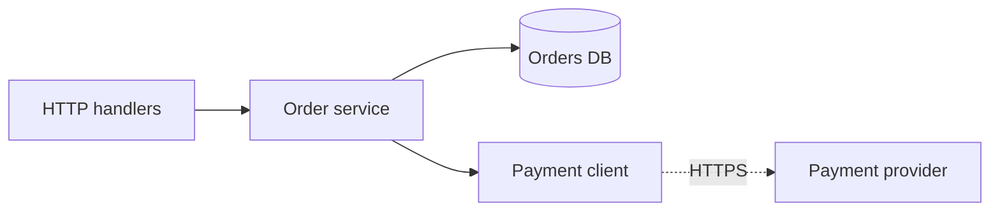
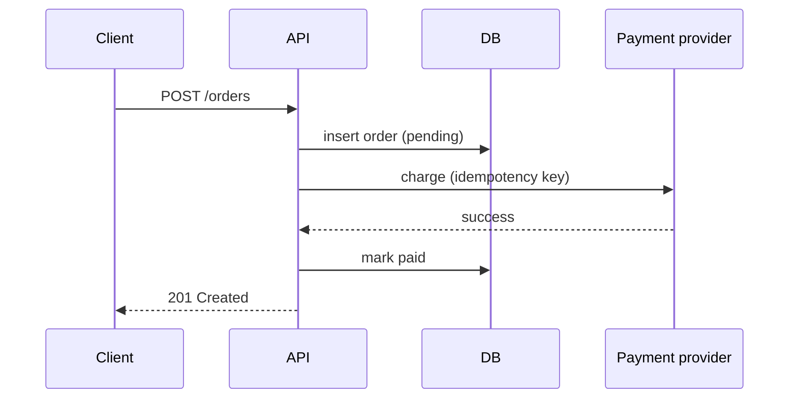
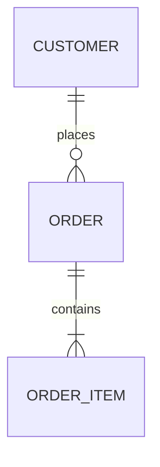

# Architecture planner reference

Open the section you need. None of this is a list of defaults to apply.

## Pattern guide

| Pattern | Worth it when | Not worth it when |
|---|---|---|
| **Layered / modular** | Several distinct concerns (API, domain, persistence) that change for different reasons | A small script or single-purpose tool. Use plain functions in a few files |
| **Domain logic separated from infrastructure** | Business rules are non-trivial and need testing without a DB or network | Logic is mostly CRUD passthrough with few rules |
| **Dependency inversion / injection** | A real second implementation exists, or a slow or unsafe dependency (network, payments, clock) must be swapped in tests | Only one implementation exists and the dependency is fast and safe to use in tests. Pass the dependency as an argument instead of using a DI framework |
| **Repository** | The persistence details are complex, or you need to isolate domain logic from the storage technology | The ORM or query builder already gives a clean API. A repository would just forward calls |
| **Service / application layer** | One use case coordinates several components, transactions, or side effects | It would just wrap a single call |
| **Ports and adapters (hexagonal)** | Several external integrations, a core domain that must be isolated, and a long expected lifetime | Small apps, or apps with few integrations. The cost of the ceremony outweighs the benefit |
| **Events / pub-sub** | Several independent reactions to one occurrence, or decoupling from a slow or unreliable consumer is needed | One consumer. A direct call is simpler and easier to trace |
| **Background jobs / queues** | Slow work, retries, or scheduling that shouldn't block a request | The work is fast and synchronous. You'd add infrastructure and failure modes for nothing |
| **Functional composition** | Data pipelines and transformations; the codebase is already functional | Forcing it on an idiomatically object-oriented codebase |
| **Microservices / distributed** | Independent scaling or deployment is *demonstrated*, there are team boundaries, or fault isolation is required | Almost anything else. Prefer a modular monolith with clean internal boundaries, which can be split later |

**Rule of thumb:** if you can't name the concrete problem a pattern solves *today*, don't add it.

## Data and integration checklist

**Flows**
- [ ] Where each external call happens, and what happens if it fails, times out, or is rate-limited
- [ ] Where validation happens: at the trust boundary, once
- [ ] Where data is transformed, and who owns each data shape
- [ ] Where data is persisted, and the transaction boundaries
- [ ] Retries: which operations are safe to retry, and is backoff bounded?
- [ ] Idempotency: what happens on a duplicate request, message, or job run
- [ ] Partial failure: what state is left behind mid-workflow, and how it is recovered or compensated
- [ ] Consistency: strong vs. eventual, and whether the caller can tolerate eventual
- [ ] Logging: enough context to debug a failed run, with no secrets

**Database changes**
- [ ] Schema shape and normalization fit the access patterns
- [ ] Constraints enforce invariants: NOT NULL, UNIQUE, FK, CHECK
- [ ] Indexes support the real queries, and none are unused
- [ ] Migration is backward-compatible with running code (expand, then contract) when deploys aren't atomic
- [ ] Rollback path exists, and data backfills are planned and resumable
- [ ] Data lifecycle: retention, deletion, archival

## Security and operations checklist

Scale to the risk. Skip items that don't apply.

**Security**
- [ ] Trust boundaries identified, with input validated where it crosses one
- [ ] Authentication and authorization enforced at the right layer, not only in the UI
- [ ] Secrets come from env or a secret store, never from code or logs
- [ ] Least privilege for DB users, API tokens, and service accounts
- [ ] Sensitive data minimized, encrypted where required, and redacted in logs
- [ ] New dependencies are maintained and justified, with an acceptable supply-chain risk

**Reliability and operations**
- [ ] Failure isolation: a noncritical dependency failure doesn't take down the core path
- [ ] Timeouts on every external call
- [ ] Resources (connections, files, locks) always released
- [ ] Config validated at startup, failing fast with a clear message
- [ ] Environment differences (dev, test, prod) are explicit and minimal
- [ ] Deploy and rollback procedure, and how a bad release is recovered
- [ ] Monitoring proportionate to the system: health checks, error rates, and key metrics only if they'll be watched

## Anti-patterns

| Anti-pattern | Signs | Proportionate fix |
|---|---|---|
| God module | Changes for unrelated reasons; huge import fan-in and fan-out | Split along existing seams by responsibility |
| Circular dependencies | A imports B imports A; initialization-order hacks | Move the shared concept to a lower module, or invert one dependency |
| Logic tied to infrastructure | Business rules inside SQL, HTTP handlers, or ORM hooks; untestable without a DB | Pull the rules into plain functions that receive data |
| Needless layers / indirection | Calls pass through 3+ wrappers that add nothing | Inline the pass-through layers |
| Premature generalization | Config options, plugins, or generics with one use | Make it concrete. Generalize when the second real case appears |
| Pattern overuse | A factory for a factory; a strategy with one strategy | Replace with a direct call or a plain function |
| Scattered business rules | The same rule in a controller, a script, and a query | One owner, which the others call |
| Risky shared mutable state | Globals or singletons mutated from several places; order-dependent bugs | Pass state explicitly, or give it a single owner |
| Unjustified distribution | Network calls between services that always deploy together | A modular monolith |
| Infrastructure costing more than it's worth | A queue, cache, or cluster with negligible load | Remove it, or defer it until it's needed |
| Failure-hiding error handling | Broad catches that log and continue; silent defaults | Fail explicitly at the boundary and surface errors to the caller |
| Hard-to-test design | Tests need the full stack or a lot of mocking | Separate pure logic from I/O at the boundary |

## Mermaid quick reference

Component or dependency diagram:



Sequence diagram:



ERD:



## ADR template

Write one only for decisions with lasting consequences. Store it where the project keeps docs, for example `docs/adr/NNNN-title.md`.

```markdown
# NNNN. <Decision title>

- Status: proposed | accepted | superseded by NNNN
- Date: YYYY-MM-DD

## Context
The problem, the constraints, and the forces at play.

## Decision
What we chose.

## Alternatives considered
- <Option>: why it wasn't chosen.

## Consequences
Trade-offs accepted, new risks, follow-up work.

## Revisit when
The conditions that would justify reopening this decision.
```
